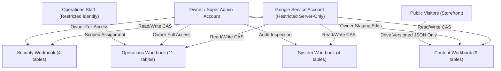

# Active continuation — 28 October 2026

Read [the refreshed Netlify free-first checkpoint](../netlify-free-first-2026-10-28/CURRENT-STATE.md) and its latest owner brief first. Netlify is live at www.rivyalivingart.com on 7b390d5; PR #71 remains draft and production is locked to the migration branch. Continue locally on codex/netlify-free-first, preserving the migration commits. Sheets/Drive is the preferred target with a conditional, justified ongoing-free database exception. The Google replacement, migration, full Studio parity and release acceptance are incomplete. Historical completion claims below are dated and superseded; simulation receipts do not certify providers, backups or production. Preserve public/login design, records/media, credentials and OLDWEBSITE. Add no products and import no archived catalogue. No production migration, publication, credential rotation or old-resource deletion has occurred in this continuation.

---

# Rivya Living Art — Owner Operating Guide & Google Workspace Manual

Date: 27 October 2026  
Status: Phase 11 Verified Local Handover  
Baseline Commit: `e9d3228` | Head: `codex/google-cloud-acceptance`  

---

## Executive Overview & Architectural Placement

Rivya Living Art transitions from legacy PostgreSQL/Vercel Blob storage to a fully serverless, highly-available Google Workspace backend comprising **Google Sheets** for structured canonical records, **Google Drive** for versioned binary artifacts/media, and a **Version-1 signed Apps Script CAS Writer Gateway**.

### Service Placement Map

| Responsibility | Authoritative Provider | Key Roles / Components |
|---|---|---|
| **Public Storefront** | Next.js on Vercel | High-performance static & dynamic pages; reads pinned Drive publication bundles; zero direct database writes. |
| **Studio Administration** | Next.js Authenticated Studio | 37 operational modules; role-based staff access; restricted server-side Google Workspace API integration. |
| **Canonical Records** | Google Sheets | 28 tables partitioned across 4 permission-isolated workbooks (`content`, `operations`, `security`, `system`). |
| **Binary Assets & CMS Snapshots** | Google Drive | 169 approved creations / 507 WebP variants; versioned JSON publication bundles; generated catalogue PDFs/Slides. |
| **Atomic Write Gate** | Google Apps Script (CAS Writer) | Script-locked HMAC-signed CAS gateway guaranteeing single-batch atomicity and optimistic concurrency. |

---

## Workbook Partition & Permission Matrix

The 28 canonical database tables are strictly partitioned into 4 Google Sheets workbooks with isolated sharing and IAM access boundaries:



### Workbook Details

1. **`rivya-living-art-content` (9 tables)**:
   - Tables: `creations`, `creation_variants`, `categories`, `cms_articles`, `cms_testimonials`, `cms_faqs`, `media_assets`, `media_associations`, `publication_revisions`.
   - Permissions: Super Admin & Server Service Account (Editor). Storefront reads via versioned Drive snapshot.
   - Staging: Owner staging permitted in designated green columns (columns M–Z).
2. **`rivya-living-art-operations` (11 tables)**:
   - Tables: `inquiries`, `inquiry_events`, `inquiry_notes`, `orders`, `order_events`, `subscribers`, `private_attachments`, `customer_preferences`, `staff_assignments`, `operations_metrics`, `privacy_requests`.
   - Permissions: Operations Staff & Super Admin. Strictly isolated from public access.
3. **`rivya-living-art-security` (4 tables)**:
   - Tables: `studio_staff`, `studio_session`, `studio_throttle`, `studio_access_request`.
   - Permissions: Super Admin & Server Service Account ONLY. Contains argon2/scrypt password hashes, session secrets, and brute-force IP rate limit trackers.
4. **`rivya-living-art-system` (4 tables)**:
   - Tables: `canonical_jobs`, `migration_crosswalks`, `mutation_audit_ledger`, `post_cutover_audit`.
   - Permissions: Automated worker processes & Super Admin audit.

---

## 1. Direct Sheet Edits and Staging

When modifying content directly within Google Sheets rather than the Studio UI, adhere to the following rules:

### Rules for Safe Sheet Edits

1. **Never edit canonical protected columns (Columns A–L):**
   - Canonical columns are locked with Google Sheets Protected Ranges.
   - To propose changes, enter values in the corresponding **Staging Columns (Columns M–Z)**.
2. **Formula Injection Safeguards:**
   - Leading characters `=`, `+`, `-`, `@`, `\t`, `\r` are automatically escaped with a leading single quote (`'`) by the record codec to prevent spreadsheet formula injection attacks.
   - Never enter executable spreadsheet formulas into customer-facing or data fields.
3. **Synchronizing Staging to Canonical:**
   - Within authenticated Studio, navigate to **Content Workspace -> Staging Review**.
   - Review field diffs and click **"Approve & Sync Batch"**.
   - The server validates data contracts, packages an atomic mutation plan, and commits changes via CAS writer.

---

## 2. Editorial CMS and Versioned Publication

Rivya Living Art employs a **pinned publication bundle** architecture. The live storefront never queries live Google Sheets directly, eliminating rate limits and preventing half-edited drafts from leaking.

### Publication Workflow

1. **Drafting Content:** Edit articles, FAQs, testimonials, or creations within Studio CMS. All edits generate `publication_revisions` in draft state.
2. **Pre-Publish Verification:**
   - Click **"Validate Publication Bundle"**.
   - The validation engine checks:
     - All referenced media asset URLs resolve to valid Drive IDs.
     - Truthful claims rule: Testimonials contain zero invented customer names or fabricated reviews.
     - Visual contracts: 169 approved creations and 507 WebP variants remain intact.
3. **Publishing Live:**
   - Click **"Publish to Production"**.
   - The system bundles the entire public projection into an immutable JSON file in Drive (`/rivya-snapshots/pub-v{timestamp}.json`).
   - The publication pointer is updated via a single CAS transaction in the System workbook.
   - Storefront requests immediately pin the new active version without cache thrashing.
4. **Instant Rollback:**
   - If a visual issue is detected, select the prior publication timestamp from **Studio -> Publication History** and click **"Rollback Pointer"**. The pointer atomically reverts to the previous immutable bundle in $< 2$ seconds.

---

## 3. Catalogue Automation and Generation

The catalogue engine generates professional multi-page presentations combining Google Slides templates with live Sheets records.

### Operational Instructions

1. **Input Snapshot Freeze:**
   - Concepts and variants are selected in **Studio -> Catalogue Automation**.
   - Clicking **"Freeze Snapshot"** creates an immutable cryptographic snapshot hash (`snapshotSha256`).
2. **Template Binding:**
   - Template 1: A4 Landscape Editorial Deck (30 slides).
   - Template 2: 4:5 Vertical Artwork Focus Deck.
   - Typography: Latin brand fonts paired with full UTF-8 Devanagari Hindi script for bilingual descriptions.
3. **Generation Dispatch:**
   - Generation runs through `catalogueWorkerAdapter` as a durable background job.
   - The worker creates a native Google Slides presentation and exports a vector PDF.
   - Outputs are stored in Google Drive under `rivya-catalogue/` with permanent, deterministic Drive IDs.
4. **Safety Invariant:**
   - The catalogue engine **strictly prohibits adding new products** to the database (`CAN_CREATE_PRODUCT = false`).

---

## 4. Scraper Candidate Research

The market research subsystem monitors 23 legacy luxury furniture and artisanal decor vendors for price benchmarks and material trends.

### Research Workflow

1. **Vendor Adapter Rules:**
   - Only registered vendors with status `ACTIVE` and permitted access method `DIRECT_READ` can be scraped.
   - Bounded concurrency: maximum 2 concurrent worker threads, strictly respecting rate limits (minimum 2500ms delay between requests).
2. **Reviewing Candidates:**
   - Scraped items enter the **Candidate Review Queue** (`/studio/scraper/review`).
   - Each item includes source URL, title, detected materials, observed pricing, and screenshot thumbnail.
3. **Strict Product Creation Prohibition:**
   - **`CAN_CREATE_PRODUCT = false` is enforced in source code.**
   - Clicking "Map to Creation" allows associating observations as market benchmarks to *existing* creations; it will NEVER create a new production product.

---

## 5. Customer Inquiries, Orders, and Private Attachments

1. **Inquiry Management:**
   - Inquiries submitted via the storefront contact form are ingested into the `operations` workbook with an initial status of `NEW`.
   - Operations staff can assign inquiries, append notes, and transition statuses (`NEW` $\rightarrow$ `IN_REVIEW` $\rightarrow$ `CONTACTED` $\rightarrow$ `CONVERTED` $\rightarrow$ `ARCHIVED`).
2. **Private Attachments:**
   - Architectural plans, room photos, and bespoke dimension documents uploaded by clients are stored in private Google Drive folders (`rivya-private-attachments/`).
   - Private media is accessible only via time-limited signed proxy URLs generated by authenticated Studio sessions; direct public Drive links are disabled.

---

## 6. Controlled Cutover & Authorization Protocol

Execution of the storage cutover from PostgreSQL to Google Workspace requires explicit owner authorization.

### Cutover Execution Steps

1. **Authorization Gate:**
   - The cutover engine requires the environment variable `RIVYA_CUTOVER_AUTHORIZED=true` and an authorized execution token.
   - In the absence of authorization, the system safely runs simulated dry-runs.
2. **Write Pause Protocol:**
   - Inbound write operations are paused for a bounded window ($\le 30$ seconds budget).
   - In-flight requests drain cleanly within 5 seconds.
3. **Delta Sync & Pointer Switch:**
   - The sync planner commits final delta rows to Sheets without deleting any canonical data.
   - Storage authority transitions atomically to `google-workspace`.
   - SQL connections are permanently severed with `SqlDisabledError`.
   - Post-cutover audit ledger (`post_cutover_audit`) is armed.

---

## 7. Emergency Abort and Rollback Procedure

If any anomaly or provider outage occurs during or immediately following cutover:

1. **Rollback Trigger:**
   - Navigate to **Studio -> System Operations -> Emergency Rollback**, or run CLI rollback:
     ```powershell
     node --import tsx tools/google-workspace/cutover-cli.mjs rollback --reason "Provider latency spike"
     ```
2. **Recovery Budget (< 15 seconds):**
   - The authority state machine immediately sets authority back to `postgres`.
   - Inbound write pauses are released.
   - The system reads all events recorded in `post_cutover_audit` and replays them into PostgreSQL to guarantee zero customer data loss.

---

## 8. Durable Job Leasing and Recovery

Background processes (catalogue generation, media optimization, delta sync) are managed by the canonical job store:

- **Lease Duration:** Jobs acquire 300-second leases with automatic heartbeat renewals.
- **Worker Failure:** If a worker crashes, the lease expires; a secondary worker resumes execution from the last saved checkpoint payload.
- **Idempotency:** Re-running a completed job returns the existing Drive artifact ID without re-executing generation.

---

## 9. Routine Maintenance & Health Commands

Run these safe, read-only commands to inspect system health:

```powershell
# 1. Verify all Google Workspace test suites (60/60 passing)
node --import tsx --test tests/google-workspace-*.test.mjs

# 2. Run repository preflight suite (12/12 passing)
npm run test:preflight

# 3. Check TypeScript compilation (0 errors)
npm run typecheck

# 4. Check ESLint conformance (0 errors, 62 baseline warnings)
npm run lint
```
